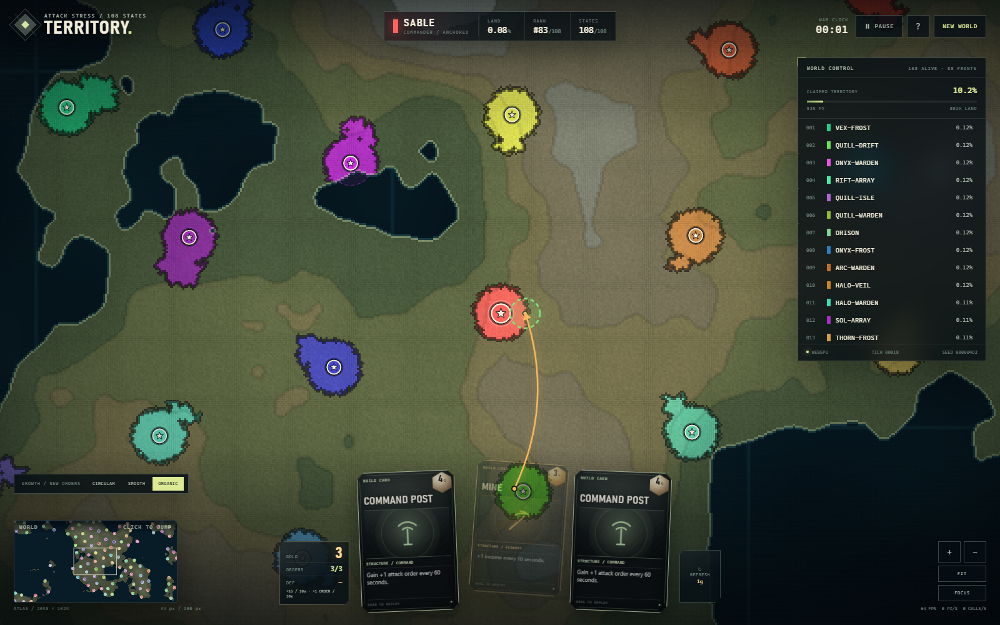

# TERRITORY

**A deterministic, WebGPU-rendered pixel territory war.** Every pixel of the 2048 × 1024 atlas is land, ocean, or somebody's country.



<details>
<summary>More screens</summary>


</details>

> **Status: Frontage v1 + Ports (v0.53.0).** One **supply** resource pays for cards, upgrades, and durable fronts. Fronts trade strength on contact, idle out after 20 captureless ticks, and can be cancelled for a proportional refund. Holding **70% of land wins instantly**; an optional match timer awards the largest alive state.
>
> **AI commanders:** 50 bots receive deterministic personality traits and per-type structure affinities. Every bot opens with a shared supply ramp: alternate early Command Posts and War Academies until it has two of each, expanding into neutral ground without opening state wars where possible. After that, each economy tick scores build/upgrade actions by affinity, threat, income, cap pressure, novelty, diminishing returns, and affordability, then saves for a strategic aspiration instead of permanently buying the cheapest option. Attack frequency is target-utility driven rather than a flat aggression roll; target selection also prefers the lowest-defense contact ground. High-value grudges/opportunities attract attacks, while threatened or saving bots hold supply. Bots also prioritise expansion when existing districts leave no legal site for a missing structure.
>
> The current build runs **8–51 states** (default 51: 1 human + 50 AI), three map presets, three growth layers, optional match timers, and three bot difficulties. Online multiplayer remains specified but **not wired up**.
>
> **Combat replacement:** the next attack model is proposed in [docs/COMBAT_DESIGN.md](docs/COMBAT_DESIGN.md); it is not implemented. Headless balance data comes from `pnpm telemetry`, `pnpm balance`, and `pnpm soak` ([docs/TELEMETRY.md](docs/TELEMETRY.md)).
>
> **Rules source of truth:** code and tests are authoritative; generated values live in [docs/REFERENCE.md](docs/REFERENCE.md) (`pnpm docs:reference`, checked by `pnpm docs:check`).

---

## What this build demonstrates

| Area            | Implementation                                                                                                                                                 |
| --------------- | -------------------------------------------------------------------------------------------------------------------------------------------------------------- |
| Frontage v1     | 8–51 states, durable supply-bought fronts, mutual strength attrition, cancellation/refunds, 70% or timer victory                                               |
| Large pixel map | 2,097,152 ownership cells rendered from a single GPU control texture, nearest-neighbour sampled, with pixel-grid and terrain shader detail                     |
| Terrain defense | Six elevation tiers color the map; defense is `1 + elevation + occupied + aura`; Barracks levels scale cost/strength linearly and speed/pierce logarithmically |
| State auras     | Live capitals project a 16 px field of +20 defense                                                                                                             |
| Supply economy  | 90 starting supply, uncapped maximum, seven cards always available, compact HUD amounts, repeatable level-scaled builds/upgrades                               |
| Bot commanders  | 50 deterministic utility-driven bots with personality affinities, strategic savings, threat response, expansion pressure, retaliation, and opportunism         |
| Rival banners   | Transparent name/supply text at rival capitals, sized by territory and capped to the state's on-screen footprint; hidden when too small to fit                 |
| Districts       | Bounded owner-local Voronoi districts with noisy extents/borders, type tint/boundaries, district-wide defense auras, same-type stacking                        |
| Determinism     | Fixed 10 Hz tick, seeded integer PRNG, stable command order, FNV-1a checksums, deterministic tests                                                             |
| Rendering speed | Full-screen WebGPU pass; changed 32 × 32 tiles are merged into strips, with heavy-load full resyncs split across frames to protect input                       |
| Naval           | Shore Ports, deterministic sea routing, sailing boats, beachhead landing, auto-Port, sea-linked annex protection                                               |
| Match setup     | State count, three map presets, bot difficulty, growth layer, optional timer, saved defaults                                                                   |
| UI scale        | Virtualized state-count-aware leaderboard (only visible rows in DOM), 5 Hz HUD snapshots, generated palette, minimap, attack counters, perf readout            |
| Onboarding      | Three dismissible first-match hints: launch a front, build a card, upgrade a district; persisted locally                                                       |
| Touch           | One-finger pan/tap, two-finger pinch zoom, compact hand/minimap/tool layout                                                                                    |
| Keyboard        | Arrow-key map cursor, Enter attacks/upgrades, Shift moves faster, Esc clears, live screen-reader status                                                        |
| Tooling         | SvelteKit 3 + Svelte 5 + TypeScript, Vitest determinism/stress tests, benchmark + headless telemetry scripts, CI workflow                                      |

## Quick start

**Requirements:** Node.js ≥ 24, pnpm ≥ 11, and a WebGPU-enabled browser (current Chrome or Edge on desktop).

```sh
pnpm install
pnpm dev
```

Open the URL printed by Vite (normally <http://localhost:5173>). Append a seed to replay a world:

```text
http://localhost:5173/?seed=1234
```

### Commands

```sh
pnpm dev        # Vite dev server (HMR)
pnpm check      # svelte-check + TypeScript
pnpm test       # deterministic + 50-bot stress tests
pnpm bench      # map/tick/checksum benchmark
pnpm telemetry  # headless multi-seed match telemetry
pnpm balance    # personality/ramp/structure balance sweep
pnpm soak       # 10k-tick deterministic soak test
pnpm docs:reference # regenerate docs/REFERENCE.md from code
pnpm docs:check     # fail if generated rules docs are stale
pnpm build      # production build via adapter-node
pnpm preview    # preview the production build
pnpm lint       # Prettier check
pnpm format     # Prettier write
```

## Controls

| Input                       | Action                                                          |
| --------------------------- | --------------------------------------------------------------- |
| Click / tap a shared border | Buy a durable front with supply                                 |
| Click / tap your district   | Upgrade that district's structure with supply                   |
| Shift + click your district | Queue 5 upgrades at once                                        |
| Ctrl + click your district  | Disable visual merging; upgrade the clicked structure           |
| `1`–`7`                     | Start placing that card; left-click builds, right-click cancels |
| Drag                        | Pan the map                                                     |
| Scroll                      | Zoom at the pointer                                             |
| Two-finger pinch            | Zoom on touch                                                   |
| Arrow keys / `Enter`        | Move keyboard cursor / attack or upgrade                        |
| `X`                         | Cancel latest front                                             |
| `A` / FIRE                  | Enter artillery targeting; click an aim point in range          |
| `Space`                     | Pause / resume the simulation                                   |
| `F` / `C`                   | Fit atlas / return to beachhead                                 |
| `H`                         | Open the field manual                                           |
| Minimap click               | Jump the camera                                                 |
| Growth switcher             | Select circular / smooth / organic for **new** fronts           |
| Drag a build card           | Drop on controlled land to buy/build that structure             |

A click must be on land near a shared border. The simulation reports ocean, own territory, no-shared-border, and insufficient-supply failures.

## How Frontage v1 works

1. Click a target cell near your frontier.
2. The simulation finds up to 96 target-owned cells within 34 px that touch your territory.
3. Effective levels are `max(0, attacker Barracks stacks − defender Jammer stacks)`. A launch costs **30 supply + 40 per effective level**.
4. Each front gains durable strength `1000 + 200 × effective levels`. Speed and piercing use `logTier = floor(log2(effective levels + 1))`: power `30 + 15 × logTier`, piercing `logTier`. Repeated clicks create separate fronts.
5. Each capture costs `max(1, defense − logTier)` from both the per-tick power and the durable strength pool.
6. A front captures connected target-owned pixels while it has power and strength. High ground and occupied land fall more slowly.
7. Every captured pixel must still touch the attacker's territory at capture time. Cut connections discard queued pixels.
8. If a front captures nothing for 20 consecutive ticks, it dies. A clash pause resets the idle counter.
9. **Least resistance:** each capture samples 10 high-priority frontier cells and takes the cheapest local defense.
10. **Cancellation:** cancel the latest front with `X` or the HUD button. Refund = `floor(launchCost × remainingStrength / initialStrength)`.
11. **Mutual fronts attrit:** both sides lose `100 + 50 × opponent logTier` strength simultaneously, once per pair per tick. A front at zero dies; the survivor holds the contact line.
12. **Artillery:** costs 1000 supply, needs 16 px of district-free ground, and covers a 64 px district. `A` or FIRE, then click a raw aim point (no snapping). Every ready battery in 140 px fires one shell per level at 300 supply per level; after 2 s each shell lands with ±36 px spread and removes one level from a non-State structure within 12 px. Batteries reload for 6 s; States are immune.
13. **Ports:** Ports cost 200 supply and can only be built on owned shoreline. A Port lets you click any non-friendly shore with a sea route; a boat sails there at 80 px/s, claims a beachhead, auto-builds another Port, and opens a regular inward front. Ports whose land reaches your State protect their component, as do ports sharing a sea with such a port.
14. **Victory:** holding **70% of land** wins immediately. Otherwise the last living state wins; an optional match timer awards the largest alive state.
15. **State structures anchor territory:** every component connected to a live State structure is protected from annexation.
16. **Detached land is annexed:** every second, unprotected land touching a foreign protected mainland transfers to the largest shared border owner. Capturing a State destroys its annexation protection.
17. **Small neutral specks are cleaned up:** every 10 seconds, neutral pockets ≤96 cells bordering an owner are filled into the dominant owner.

### Terrain and defense

The map has six discrete elevation tiers: **lowland, plains, hills, highlands, mountains, peaks**. Elevation is part of the generated map, rendered as a green-to-ochre-to-grey-to-snow palette and marked with subtle contour boundaries.

| Property                 | Value                                     |
| ------------------------ | ----------------------------------------- |
| Base defense             | `1 + elevation tier` (1–6)                |
| Occupied bonus           | `+1`                                      |
| State aura               | `+20` within 16 px, max once              |
| Supply launch cost       | `30 + 40 × effective levels`              |
| Durable strength         | `1000 + 200 × effective levels`           |
| Speed / piercing tier    | `floor(log2(effective levels + 1))`       |
| Power per front per tick | `30 + 15 × logTier`                       |
| Capture cost             | `max(1, defense − logTier)`               |
| Contact attrition        | `100 + 50 × opponent logTier` per tick    |
| Command Post             | +1 supply per second                      |
| War Academy              | +80 supply cap; cap has no global maximum |
| Jammer                   | Global −1 enemy effective attack level    |

Hovering a land cell updates the compact defense readout beside the card hand; its tooltip shows elevation, base defense, and aura details. Grid reference and target-description panels were removed to keep vertical space clear.

### Growth layers

The HUD selector switches the frontier-selection strategy used by attacks created from the next tick onward. Existing fronts keep the layer they started with, so you can compare layers in the same match.

| Layer        | Behavior                                                                              |
| ------------ | ------------------------------------------------------------------------------------- |
| **Circular** | Euclidean-priority frontier; expands as a digital disc instead of a Manhattan diamond |
| **Smooth**   | Radial bands with concavity filling; suppresses tangent wings and thin spikes         |
| **Organic**  | Deterministic random frontier selection; irregular, organic lobes                     |

Circular and smooth both grow radially from the border and can look similar by design; smooth trades exact circularity for banded concavity filling. Organic is the visually distinct mode.

### Structures

Each state starts with one **State structure** at its capital. It is the anchor for that state's protected mainland: every territory component connected to a live State structure cannot be annexed. The structure is visible as a large owner-colored circle with a cream capital star on the map, and a ringed dot on the minimap.

The State also projects a **16 px defensive aura** that adds **+20 defense** to every land pixel inside it. Overlapping auras use the strongest bonus, not a sum. Aura circles were removed; districts provide the territorial tint instead.

State structures can be captured like any other land cell. The structure is destroyed when its cell changes owner; its aura disappears immediately, and the state keeps its territory but loses annexation protection. The top bar shows the human state's anchored status.

### Build cards

Each rival state has a **map-anchored supply banner** at its capital showing its name and current supply. Banners scale with territory but are capped by the state's on-screen footprint, so zooming out shrinks or hides them instead of covering the map. They use transparent backgrounds with no border or plaque; larger states still get larger text. The human state is intentionally excluded because its supply is shown in the hand bar.

The human commander starts with **90 supply** and **all seven build cards** permanently available, sorted ascending by cost. Supply income is `3 + floor(territory/3000) + structures` per second with **no income cap** (+1/s per 3,000 owned pixels); cap is `120 + floor(territory/1000) + 80 × War Academy stacks`, with **no global maximum**. HUD amounts use three significant digits (`42,5k`). Drag any affordable card into your territory, or press its number key `1`–`7` and left-click the map; right-click cancels placement. Cards are never consumed. Clicking a district, or dropping a matching card inside it, upgrades one level for **base cost + 15 × current level**; Shift-click queues five levels atomically. A cursor tooltip shows the total cost (and updates to the five-level total while Shift is held):

| Card          | Cost | Effect                                                       |
| ------------- | ---- | ------------------------------------------------------------ |
| Artillery     | 1000 | Active: inaccurate, 300 supply/level, 64 px district         |
| Barracks      | 240  | +1 effective attack level; +40 cost, +200 strength per level |
| Fortification | 40   | +1 defense to every friendly pixel in its district; stacks   |
| Jammer        | 160  | Global −1 enemy effective Barracks level per stack           |
| Command Post  | 80   | +1 supply per second                                         |
| War Academy   | 60   | +80 supply cap                                               |
| Port          | 200  | Shore-only naval landing port; sea-linked annex protection   |

There is no deck, draw, or reroll. Built structures are razed when captured.

Defensive auras only protect land owned by the structure's owner. A Fortification covers its **entire district**. Barracks adds attack strength/cost linearly and speed/piercing by log2 tiers, with no cap. Jammers reduce every enemy attacker's effective Barracks levels by their stack count, without adding pixel defense.

### Districts

Every buildable structure claims a **district** from its owner's territory. State capitals are aura anchors only; they do not claim a district, so they never lock the whole starting territory out of building:

- districts are a constrained Voronoi split: each owned cell belongs to the nearest eligible structure of that owner;
- a district never crosses an ownership border or exceeds its structure's range;
- districts cannot overlap;
- auras only affect the owning structure's district;
- multiple structures and districts of the same type are allowed;
- dropping the same type inside a district **stacks** onto that district's structure, multiplying its effect;
- dropping the same type outside all districts creates another structure/district;
- a different type cannot be dropped inside any existing district;
- touching districts of the **same owner and type** merge visually: internal seams and fill variants disappear, and one combined-level icon replaces the individual icons;
- clicking a merged district upgrades its **lowest-level structure first** (five-level batches spread across the lowest structures); holding **Ctrl** disables merging, restores individual borders/icons, and upgrades whichever structure is under the cursor.

| Structure     | District range | Stack effect               |
| ------------- | -------------: | -------------------------- |
| Artillery     |             64 | active siege               |
| Barracks      |             44 | +1 attack level            |
| Port          |              0 | naval anchor (no district) |
| Fortification |             40 | +1 defense                 |
| Jammer        |             32 | −1 enemy level             |
| Command Post  |             32 | +1 supply/s                |
| War Academy   |             32 | +80 supply cap             |

District extents and borders are perturbed by deterministic integer noise: coherent 8 px value noise plus fine jitter makes each district grow or shrink by roughly two pixels and gives Voronoi splits an irregular edge. The geometry follows the actual coverage used by auras and placement.

District pixels receive a subtle structure-type tint, a per-district brightness variant, and a **sharp contrasting cream/amber border** in the WebGPU territory shader, so districts stay legible against matching terrain. While placing a card, the player's existing districts of that type pulse with a warm highlight and amber outline. When merging is active, the shader compares same-owner/same-type districts by type base and drops their internal seams; Ctrl restores the per-district variants and seams.

Structures must be at least **8 px apart** (centre to centre); dropping a new type too close to any existing structure is rejected. Structure icons are larger now: 15 px radius for the human State, 11 px for AI States, and 10 px for buildables. These are screen-space sizes, so icons do **not** grow as you zoom in.

The hand is presented as free-floating CCG-style cards at the bottom center, with no enclosing tray and no empty placeholders: cards enter from below, lift on hover, and tilt while dragged. The hand sinks to a semi-hidden peeking strip when the pointer leaves and rises when the pointer returns to it. The native drag ghost is suppressed; a curved accent arrow follows the cursor, and the landing circle shows the 8 px exclusion radius in green or red. Supply is a horizontal bar that fills toward the cap, with current supply inline on the left and max on the right. It sits just above the collapsed hand and slides behind raised cards. Hovering a valid attack, upgrade, or artillery target overlays the impending cost as a red segment with a label. Income, cancellation, and FIRE controls share the meta row.

The HUD shows **supply / cap** as a horizontal fill bar plus an artillery `FIRE` control; the old supply/front/defense panel is gone. Supply accrues from territory and structures; Command Posts add +1/s, War Academies +80 cap with no maximum. Barracks levels add +40 launch cost and +200 strength each; power and piercing grow by log2 tiers. Jammers suppress enemy effective Barracks levels globally. Artillery fires inaccurate 300-supply shells and cannot destroy a State.

This is deliberately provisional. See [docs/EXPERIMENTS.md](docs/EXPERIMENTS.md) for the stress rules and the exit plan.

## Architecture at a glance

```text
Svelte UI (+page.svelte)
  └── GameCanvas.svelte ......... fixed-step driver, pointer input, camera bridge
        ├── TerritorySimulation .. pure deterministic game core
        │     ├── generateMap .... seeded, versioned configurable atlas + state starts
        │     ├── TerritoryRng ... mulberry32
        │     ├── growth/ ........ circular / smooth / organic frontier layers
        │     ├── Structures/ .... one file per structure type + registry
        │     ├── integrity.ts ... annexation + neutral-pocket cleanup
        │     └── attacks ........ durable fronts, strength attrition, refunds
        ├── TerritoryRenderer .... WebGPU device, shader, adaptive chunked uploads
        └── MapCamera ............ CSS-pixel camera, zoom, free overscroll pan
  └── Minimap.svelte ............ 2D overview, throttled independent redraw
```

Read [docs/ARCHITECTURE.md](docs/ARCHITECTURE.md) for module responsibilities and data flow.

## Measured baseline

Ballpark figures from the included benchmark on the development machine (Windows, Node 24, headless Chrome with hardware acceleration). Treat them as regression baselines, not universal claims.

| Measurement                               | Result                                               |
| ----------------------------------------- | ---------------------------------------------------- |
| Map generation + 51 starts                | ~230 ms, one-time on world creation                  |
| Default (circular) all-bot attack tick    | ~1.3 ms                                              |
| Smooth-layer all-bot attack tick          | ~1.3 ms                                              |
| Organic-layer all-bot attack tick         | ~1.1 ms                                              |
| Full-state checksum                       | ~18.1 ms (on-demand; includes claim provenance)      |
| Browser render loop with cards + auras    | 142 fps; p99 7.1 ms; isolated cleanup spikes         |
| Upload strategy under stress              | adaptive full-texture chunks: ~21M px/s, ~80 calls/s |
| Full control texture                      | 8 MiB VRAM + 8 MiB CPU shadow                        |
| Node benchmark RSS (all benchmark worlds) | ~296 MiB                                             |

At 10 Hz, the attack-heavy simulation uses roughly 2.6–3.3% of a 100 ms tick budget depending on growth layer. Territory-integrity scans run once per second, with neutral-pocket cleanup every 10 seconds. Panning smoothness is protected by spreading heavy texture uploads across frames and by keeping the 51-row leaderboard virtualized to the visible window. See [docs/PERFORMANCE.md](docs/PERFORMANCE.md).

## Determinism guarantees

1. Every client and server runs the same simulation code at the same fixed 10 Hz tick.
2. The map is generated deterministically from a 32-bit seed and a **map version**. Changing map or start generation requires bumping `MAP_VERSION`.
3. Attack outcomes depend on integer positions, ownership, queue order, and command order — never on frame rate, camera, or rendering.
4. Bots draw from one seeded PRNG in a fixed player order.
5. Commands are applied at tick boundaries in a stable order.
6. State checksums can be compared across clients and servers; a mismatch forces a resync rather than silently diverging.

The attack experiment is still subject to the full determinism contract in [docs/DETERMINISM.md](docs/DETERMINISM.md).

## Project map

```text
src/
  app.css                        design tokens and resets
  routes/
    +page.svelte                 game shell, HUD, overlays, controls
    +page.ts                     client-only route (ssr = false)
  lib/
    components/
      GameCanvas.svelte          canvas lifecycle, fixed loop, pointer handling
      Minimap.svelte             throttled 2D overview
    game/
      constants.ts               Frontage/supply rules, 51-state palette/names
      rng.ts                     deterministic PRNG
      map.ts                     configurable map generation and start placement
      simulation.ts              world state, fronts, bots, checksums
      simulation.test.ts         determinism, ownership, frontier, stress tests
      growth/                    switchable circular/smooth/organic frontier layers
      net/protocol.ts            multiplayer wire protocol draft
      render/
        camera.ts                pan / zoom / free overscroll camera
        camera-bridge.ts         imperative bridge for Svelte controls
        territory.wgsl.ts        full-screen WGSL map shader
        territory-renderer.ts    WebGPU setup, control texture, dirty uploads
docs/
  SPEC.md                        canonical product + technical specification
  EXPERIMENTS.md                 retired EXP-001 history and exit plan
  ARCHITECTURE.md                module responsibilities and data flow
  DETERMINISM.md                 invariants, replay, multiplayer rules
  RENDERING.md                   WebGPU pipeline and upload strategy
  NETWORKING.md                  authoritative online architecture
  PERFORMANCE.md                 budgets, benchmarks, profiling
  ROADMAP.md                     phased delivery plan
  DECISIONS.md                   architecture decision records
  README.md                      documentation index
scripts/
  benchmark.ts                   attack tick/map/checksum benchmark
AGENTS.md                        orientation for future coding agents
```

## Current limitations

- The economy and final attack semantics are intentionally missing; this build is not game-balanced.
- Match setup chooses states/map/difficulty/growth/timer, but there is no server lobby yet.
- Online play, accounts, matchmaking, and persistence are specified but not implemented.
- TODO: replay/post-match analysis; accessibility and 320–430px mobile validation; diplomacy/coordinated team AI. No audio/fog/spectator camera UI yet.
- Touch pan/tap and two-finger pinch zoom are supported.
- WebGPU is required. There is no WebGL/Canvas2D fallback.
- The simulation runs on the main thread.

## Documentation index

| Document                                     | Read it for                                         |
| -------------------------------------------- | --------------------------------------------------- |
| [docs/SPEC.md](docs/SPEC.md)                 | The canonical game and technical specification      |
| [docs/EXPERIMENTS.md](docs/EXPERIMENTS.md)   | Retired EXP-001 history, findings, and exit plan    |
| [docs/ARCHITECTURE.md](docs/ARCHITECTURE.md) | Code map, data flow, extension points               |
| [docs/DETERMINISM.md](docs/DETERMINISM.md)   | Rules that keep every client in lockstep            |
| [docs/RENDERING.md](docs/RENDERING.md)       | WebGPU pipeline, texture layout, upload batching    |
| [docs/NETWORKING.md](docs/NETWORKING.md)     | Authoritative server, protocol, latency, anti-cheat |
| [docs/PERFORMANCE.md](docs/PERFORMANCE.md)   | Budgets, measured baseline, profiling playbook      |
| [docs/ROADMAP.md](docs/ROADMAP.md)           | Phased plan and acceptance criteria                 |
| [docs/DECISIONS.md](docs/DECISIONS.md)       | Why the stack and engine work this way              |
