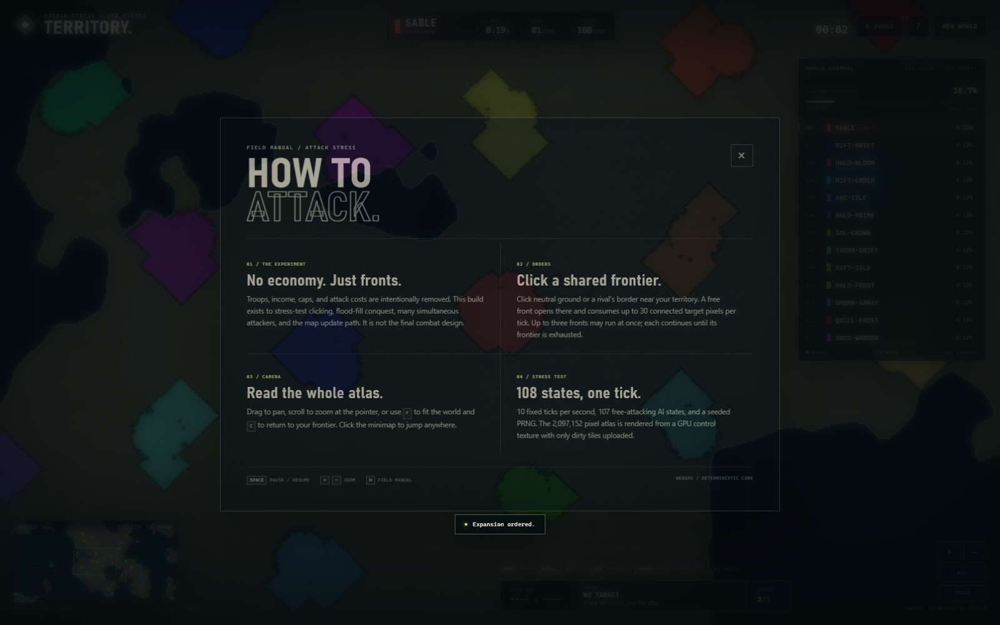

# TERRITORY

**A deterministic, WebGPU-rendered pixel territory war.** Every pixel of the 4096 × 2048 atlas is land, ocean, or somebody's country.


<details>
<summary>More screens</summary>




</details>

> **Status: Frontage v1 + Ports + Evolution Gauntlet.** One **supply** resource pays for cards, upgrades, and durable fronts. Fronts trade strength on contact, idle out after 20 captureless ticks, and can be cancelled for a proportional refund. Holding **70% of land wins instantly**; an optional match timer awards the largest alive state.
>
> **AI commanders:** main-game bots are seeded from **21 gauntlet survivors** (seed 1236, run 24), followed by any locally saved Evolution Lab buckets. Genomes carry deterministic personality traits, per-type structure affinities, and optional semi-Markov strategic controllers. Every bot opens with a shared supply ramp, scores build/upgrade actions by affinity, threat, income, cap pressure, novelty, diminishing returns, and affordability, and converts strategic modes into build/attack priorities. Attack frequency is target-utility driven rather than a flat aggression roll; high-value grudges/opportunities attract attacks, while threatened or saving bots hold supply.
>
> The main game runs **8–51 states** (default 51: 1 human + 50 AI), three map presets with arbitrary custom atlas sizes, locked organic growth, optional match timers, and three bot difficulties. The **Evolution Lab** runs worker-driven population evolution and a **64-bot, 3-life gauntlet** with top-16 life recovery, JSON state export/import, and IndexedDB session restore. Online multiplayer rooms are wired through an authoritative HTTP/SSE server.
>
> **Rules source of truth:** code and tests are authoritative; generated values live in [docs/REFERENCE.md](docs/REFERENCE.md) (`pnpm docs:reference`, checked by `pnpm docs:check`). AI balance results live in [docs/AI_BALANCE.md](docs/AI_BALANCE.md); headless evolution findings live in [docs/EVOLUTION_AUDIT.md](docs/EVOLUTION_AUDIT.md).

---

## What this build demonstrates

| Area            | Implementation                                                                                                                                                                                 |
| --------------- | ---------------------------------------------------------------------------------------------------------------------------------------------------------------------------------------------- |
| Frontage v1     | 8–51 states, durable supply-bought fronts, mutual strength attrition, cancellation/refunds, 70% or timer victory                                                                               |
| Large pixel map | 8,388,608 ownership cells by default; arbitrary atlas dimensions up to 8192 px per side and 67M total cells, rendered from one GPU control texture                                             |
| Terrain defense | Six elevation tiers color the map; defense is `1 + elevation + occupied + aura`; Barracks levels scale cost/strength linearly and speed/pierce logarithmically                                 |
| State auras     | Live capitals project a 16 px field of +20 defense                                                                                                                                             |
| Supply economy  | 90 starting supply, uncapped maximum, seven cards always available, compact HUD amounts, repeatable level-scaled builds/upgrades                                                               |
| Bot commanders  | Gauntlet-survivor genome roster, deterministic trait/module affinities, semi-Markov strategic options, threat response, expansion pressure, retaliation, opportunism, tick-staggered decisions |
| Diplomacy       | Player-only alliances: one active request, bot acceptance, non-aggression, coordination, expiry, betrayal cooldown                                                                             |
| Online rooms    | `/online`: up to eight human seats, bots fill the rest, authoritative 10 Hz server, HTTP intents, SSE snapshots, reconnect baseline, 200-player/25-room caps                                   |
| Worker local    | Local sim stepping, bot decisions, and integrity scans run in a Web Worker; main thread renders mirror deltas and sends async commands                                                         |
| Rival banners   | Name/supply/affordable-front text on a dark translucent plate at rival capitals, sized by territory and capped to the state's on-screen footprint; hidden when too small to fit                |
| Districts       | Bounded owner-local Voronoi districts with noisy extents/borders, type tint/boundaries, district-wide defense auras, same-type stacking                                                        |
| Determinism     | Fixed 10 Hz tick, seeded integer PRNG, stable command order, FNV-1a checksums, deterministic tests                                                                                             |
| Rendering speed | Full-screen WebGPU pass; changed 32 × 32 tiles are merged into strips, with heavy-load full resyncs split across frames to protect input                                                       |
| Naval           | Shore Ports, deterministic sea routing, sailing boats, beachhead landing, auto-Port, sea-linked annex protection                                                                               |
| AI Evolution    | Worker-driven population evolution, 64-bot gauntlet with lives/top-16 recovery, semi-Markov genomes, fitness history, CSV, IndexedDB restore, JSON state transfer                              |
| AI strategy     | Main-game roster seeded by 21 gauntlet survivors then saved buckets; committed options/blackboard, deterrence, naval campaigns, teams, behavior telemetry                                      |
| Post-match      | Result summary with AI behavior counters, standings, seed copy/replay                                                                                                                          |
| Match setup     | State count, three map presets or custom width/height, bot difficulty, optional timer, 500-stack bot Command Post surge, saved defaults                                                        |
| UI scale        | Virtualized state-count-aware leaderboard (only visible rows in DOM), 5 Hz HUD snapshots, generated palette, minimap, attack counters, perf readout                                            |
| Onboarding      | Three dismissible first-match hints: launch a front, build a card, upgrade a district; persisted locally                                                                                       |
| Touch           | One-finger pan/tap, two-finger pinch zoom, compact hand/minimap/tool layout                                                                                                                    |
| Keyboard        | Arrow-key map cursor, Enter attacks/upgrades, Shift moves faster, Esc clears, live screen-reader status                                                                                        |
| Tooling         | SvelteKit 3 + Svelte 5 + TypeScript, Vitest fast/stress suites, benchmark/telemetry/soak scripts, release checklist, CI workflow                                                               |

## Quick start

**Requirements:** Node.js ≥ 24, pnpm ≥ 11, and a WebGPU-enabled browser (current Chrome or Edge on desktop).

```sh
pnpm install
pnpm dev
```

Open the URL printed by Vite (normally <http://localhost:5173>). Append a seed to replay a world:

```text
http://localhost:5173/?seed=1234
```

Open the Evolution Lab at <http://localhost:5173/evolution>.
Open authoritative online rooms at <http://localhost:5173/online> (in-memory MVP; the same server process hosts rooms and SSE ticks).

### Commands

```sh
pnpm dev        # Vite dev server (HMR)
pnpm check      # svelte-check + TypeScript
pnpm test       # full deterministic, stress, economy, and AI-evolution suite
pnpm test:fast  # fast suite; excludes the long simulation/evolution stress files
pnpm test:stress # only simulation + evolution stress tests
pnpm bench      # map/tick/checksum benchmark
pnpm bench:online # enforce the 200-player online capacity target
pnpm telemetry  # headless multi-seed match telemetry
pnpm balance    # personality/ramp/structure balance sweep
pnpm soak       # 10k-tick deterministic soak test
pnpm evolution  # headless natural-selection sandbox → CSV spreadsheet
pnpm ai:balance # 8×6000 AI behavior/balance matrix
pnpm docs:reference # regenerate docs/REFERENCE.md from code
pnpm docs:check     # fail if generated rules docs are stale
pnpm build      # production build via adapter-node
pnpm preview    # preview the production build
pnpm lint       # Prettier check
pnpm format     # Prettier write
```

## Controls

| Input                       | Action                                                          |
| --------------------------- | --------------------------------------------------------------- |
| Click / tap a shared border | Buy a durable front with supply                                 |
| Click / tap your district   | Upgrade that district's structure with supply                   |
| Shift + click your district | Queue 5 upgrades at once                                        |
| Ctrl + click your district  | Disable visual merging; upgrade the clicked structure           |
| Right-click a structure     | Open structure actions; first item demolishes it (no refund)    |
| Right-click rival territory | Request an alliance; active ally shows BREAK ALLIANCE           |
| `1`–`7`                     | Start placing that card; left-click builds, right-click cancels |
| Drag                        | Pan the map                                                     |
| Scroll                      | Zoom at the pointer                                             |
| Two-finger pinch            | Zoom on touch                                                   |
| Arrow keys / `Enter`        | Move keyboard cursor / attack or upgrade                        |
| `X`                         | Cancel latest front                                             |
| `A` / FIRE                  | Enter artillery targeting; click an aim point in range          |
| `Space`                     | Pause / resume the simulation                                   |
| `F` / `C`                   | Fit atlas / return to beachhead                                 |
| `H`                         | Open the field manual                                           |
| Minimap click               | Jump the camera                                                 |

| Drag a build card | Drop on controlled land to buy/build that structure |

A click must be on land near a shared border. The simulation reports ocean, own territory, no-shared-border, and insufficient-supply failures.

## How Frontage v1 works

1. Click a target cell near your frontier.
2. The simulation finds up to 96 target-owned cells within 34 px that touch your territory.
3. Effective levels are `max(0, attacker Barracks stacks − defender Jammer stacks)`. A launch costs **30 supply + 40 per effective level**.
4. Each front gains durable strength `1000 + 200 × effective levels`. Speed and piercing use `logTier = floor(log2(effective levels + 1))`: power `30 + 15 × logTier`, piercing `logTier`. Repeated clicks create separate fronts.
5. Each capture costs `max(1, defense − logTier)` from both the per-tick power and the durable strength pool.
6. A front captures connected target-owned pixels while it has power and strength. High ground and occupied land fall more slowly.
7. Every captured pixel must still touch the attacker's territory at capture time. Cut connections discard queued pixels.
8. If a front captures nothing for 20 consecutive ticks, it dies. A clash pause resets the idle counter.
9. **Least resistance:** each capture samples 10 high-priority frontier cells and takes the cheapest local defense.
10. **Cancellation:** cancel the latest front with `X` or the HUD button. Refund = `floor(launchCost × remainingStrength / initialStrength)`.
11. **Mutual fronts attrit:** both sides lose `100 + 50 × opponent logTier` strength simultaneously, once per pair per tick. A front at zero dies; the survivor holds the contact line.
12. **Artillery:** costs 1000 supply, needs 16 px of district-free ground, and covers a 64 px district. `A` or FIRE, then click a raw aim point (no snapping). Every ready battery in 140 px fires one shell per level at 300 supply per level; after 2 s each shell lands with ±36 px spread and removes one level from a non-State structure within 12 px. Batteries reload for 6 s; States are immune.
13. **Ports:** Ports cost 200 supply and snap to the nearest valid owned shoreline within 24 px, so clicks on nearby water or a few pixels inland work. Ports may be placed inside unrelated districts. A Port lets you click any non-friendly shore with a sea route; the landing costs a normal attack plus the 200-supply Port cost up front. A boat sails there at 80 px/s, claims a beachhead, auto-builds the landing Port, and opens a regular inward front. Ports whose land reaches your State protect their component, as do ports sharing a sea with such a port.
14. **Victory:** holding **70% of land** wins immediately. Otherwise the last living state wins; an optional match timer awards the largest alive state.
15. **State structures anchor territory:** every component connected to a live State structure is protected from annexation.
16. **Detached land is annexed:** every 3 seconds, unprotected land touching a foreign protected mainland transfers to the largest shared border owner; large transfer queues drain across ticks. Capturing a State destroys its annexation protection.
17. **Small neutral specks are cleaned up:** every 10 seconds, neutral pockets ≤96 cells bordering an owner are filled into the dominant owner.

### Terrain and defense

The map has six discrete elevation tiers: **lowland, plains, hills, highlands, mountains, peaks**. Elevation is part of the generated map, rendered as a green-to-ochre-to-grey-to-snow palette and marked with subtle contour boundaries.

| Property                 | Value                                     |
| ------------------------ | ----------------------------------------- |
| Base defense             | `1 + elevation tier` (1–6)                |
| Occupied bonus           | `+1`                                      |
| State aura               | `+20` within 16 px, max once              |
| Supply launch cost       | `30 + 40 × effective levels`              |
| Durable strength         | `1000 + 200 × effective levels`           |
| Speed / piercing tier    | `floor(log2(effective levels + 1))`       |
| Power per front per tick | `30 + 15 × logTier`                       |
| Capture cost             | `max(1, defense − logTier)`               |
| Contact attrition        | `100 + 50 × opponent logTier` per tick    |
| Command Post             | +1 supply per second                      |
| War Academy              | +80 supply cap; cap has no global maximum |
| Jammer                   | Global −1 enemy effective attack level    |

Hovering a land cell updates the compact defense readout beside the card hand; its tooltip shows elevation, base defense, and aura details. Grid reference and target-description panels were removed to keep vertical space clear.

### Growth model

Player matches use **locked organic growth**: new fronts select uniformly from a per-attack deterministic frontier array, producing irregular lobes that are fully replayable. There is no player-facing growth selector.

Circular and smooth frontier implementations remain in the codebase for internal tests and benchmark comparisons only.

### Structures

Each state starts with one **State structure** at its capital. It is the anchor for that state's protected mainland: every territory component connected to a live State structure cannot be annexed. The structure is visible as a large owner-colored circle with a cream capital star on the map, and a ringed dot on the minimap.

The State also projects a **16 px defensive aura** that adds **+20 defense** to every land pixel inside it. Overlapping auras use the strongest bonus, not a sum. Aura circles were removed; districts provide the territorial tint instead.

State structures can be captured like any other land cell. The structure is destroyed when its cell changes owner; its aura disappears immediately, and the state keeps its territory but loses annexation protection. The top bar shows the human state's anchored status.

### Build cards

Each rival state has a **map-anchored supply banner** at its capital showing its name, current supply, and how many fronts (`N ATK`) that supply could currently launch against you. Banners scale with territory but are capped by the state's on-screen footprint, so zooming out shrinks or hides them instead of covering the map. They use a dark, semi-transparent rounded background plate with no opaque border; larger states still get larger text. The human state is intentionally excluded because its supply is shown in the hand bar.

The human commander starts with **90 supply** and **all seven build cards** permanently available, sorted ascending by cost. Supply income is `3 + floor(territory/3000) + structures + 10 × eliminations` per second with **no income cap** (+1/s per 3,000 owned pixels, +10/s for every state you erase); cap is `120 + floor(territory/1000) + 80 × War Academy stacks`, with **no global maximum**. HUD amounts use three significant digits (`42,5k`). Drag any affordable card into your territory, or press its number key `1`–`7` and left-click the map; right-click cancels placement. Cards are never consumed. Clicking a district, or dropping a matching card inside it, upgrades one level for **base cost + 15 × current level**; Shift-click queues five levels atomically. A cursor tooltip shows the total cost (and updates to the five-level total while Shift is held):

| Card          | Effect                                                       |
| ------------- | ------------------------------------------------------------ |
| Artillery     | Active: inaccurate, 300 supply/level, 64 px district         |
| Barracks      | +1 effective attack level; +40 cost, +200 strength per level |
| Fortification | +1 defense to every friendly pixel in its district; stacks   |
| Jammer        | Global −1 enemy effective Barracks level per stack           |
| Command Post  | +1 supply per second                                         |
| War Academy   | +80 supply cap                                               |
| Port          | Shore-snapped naval port; may sit inside other districts     |

Card costs and formulas live in [docs/REFERENCE.md](docs/REFERENCE.md).

There is no deck, draw, or reroll. Built structures are razed when captured.

Defensive auras only protect land owned by the structure's owner. A Fortification covers its **entire district**. Barracks adds attack strength/cost linearly and speed/piercing by log2 tiers, with no cap. Jammers reduce every enemy attacker's effective Barracks levels by their stack count, without adding pixel defense.

### Districts

Every buildable structure claims a **district** from its owner's territory. State capitals are aura anchors only; they do not claim a district, so they never lock the whole starting territory out of building:

- districts are a constrained Voronoi split: each owned cell belongs to the nearest eligible structure of that owner;
- a district never crosses an ownership border or exceeds its structure's range;
- districts cannot overlap;
- auras only affect the owning structure's district;
- multiple structures and districts of the same type are allowed;
- dropping the same type inside a district **stacks** onto that district's structure, multiplying its effect;
- dropping the same type outside all districts creates another structure/district;
- a different type cannot be dropped inside any existing district, except Ports, which are point anchors and may overlap districts;
- touching districts of the **same owner and type** merge visually: internal seams and fill variants disappear, and one combined-level icon replaces the individual icons;
- clicking a merged district upgrades its **lowest-level structure first** (five-level batches spread across the lowest structures); holding **Ctrl** disables merging, restores individual borders/icons, and upgrades whichever structure is under the cursor.

| Structure     | District range | Stack effect               |
| ------------- | -------------: | -------------------------- |
| Artillery     |             64 | active siege               |
| Barracks      |             44 | +1 attack level            |
| Port          |              0 | naval anchor (no district) |
| Fortification |             40 | +1 defense                 |
| Jammer        |             32 | −1 enemy level             |
| Command Post  |             32 | +1 supply/s                |
| War Academy   |             32 | +80 supply cap             |

District extents and borders are perturbed by deterministic integer noise: coherent 8 px value noise plus fine jitter makes each district grow or shrink by roughly two pixels and gives Voronoi splits an irregular edge. The geometry follows the actual coverage used by auras and placement.

District pixels receive a subtle structure-type tint, a per-district brightness variant, and a **sharp contrasting cream/amber border** in the WebGPU territory shader, so districts stay legible against matching terrain. While placing a card, the player's existing districts of that type pulse with a warm highlight and amber outline. When merging is active, the shader compares same-owner/same-type districts by type base and drops their internal seams; Ctrl restores the per-district variants and seams.

Structures must be at least **8 px apart** (centre to centre); dropping a new type too close to any existing structure is rejected. Structure icons are larger now: 15 px radius for the human State, 11 px for AI States, and 10 px for buildables. These are screen-space sizes, so icons do **not** grow as you zoom in.

The hand is presented as free-floating CCG-style cards at the bottom center, with no enclosing tray and no empty placeholders: cards enter from below, lift on hover, and tilt while dragged. The hand sinks to a semi-hidden peeking strip when the pointer leaves and rises when the pointer returns to it. The native drag ghost is suppressed; a curved accent arrow follows the cursor, and the landing circle shows the 8 px exclusion radius in green or red. Supply is a horizontal bar that fills toward the cap, with current supply inline on the left and max on the right. It sits just above the collapsed hand and slides behind raised cards. Hovering a valid attack, upgrade, or artillery target overlays the impending cost as a red segment with a label. Income, cancellation, and FIRE controls share the meta row.

The HUD shows **supply / cap** as a horizontal fill bar plus an artillery `FIRE` control; the old supply/front/defense panel is gone. Supply accrues from territory and structures; Command Posts add +1/s, War Academies +80 cap with no maximum. Barracks levels add +40 launch cost and +200 strength each; power and piercing grow by log2 tiers. Jammers suppress enemy effective Barracks levels globally. Artillery fires inaccurate 300-supply shells and cannot destroy a State.

## Evolution Lab and Gauntlet

Open `/evolution` to run the AI laboratory:

- **Evolution mode** scores rotating all-bot matches, breeds survivors with mutation/crossover, and maintains a QD archive, fitness history, spreadsheet import/export, and local difficulty buckets.
- **Gauntlet mode** starts up to 64 genomes in one free-for-all. Every genome has three global lives; eliminated states lose one and zero-life genomes are removed. After each run, the top 16 surviving fitness genomes recover one life.
- Gauntlet runs continue until the remaining-bot target is reached or the user stops them. `STOP` finishes the current run; `STOP IMMEDIATE` aborts it; `CONTINUE` resumes while at least two genomes remain; `DISCARD` deletes the checkpoint.
- Empty gauntlet seats can be refilled with fresh random genomes.
- Sessions checkpoint to IndexedDB after completed generations/runs and can also be exported/imported as JSON.

The main game uses the committed gauntlet survivor pool as its base bot roster, then appends locally saved Evolution Lab buckets.

## Architecture at a glance

```text
Main game — Svelte UI (+page.svelte)
  └── GameCanvas.svelte ......... fixed-step driver, pointer input, camera bridge
        ├── TerritorySimulation .. pure deterministic game core
        │     ├── generateMap .... seeded, versioned configurable atlas + state starts
        │     ├── TerritoryRng ... deterministic PRNG
        │     ├── growth/ ........ circular / smooth / organic frontier layers
        │     ├── Structures/ .... one file per structure type + registry
        │     ├── integrity.ts ... annexation + neutral-pocket cleanup
        │     ├── ai/ ............ genomes, Markov options, buckets, bot profiles
        │     └── attacks ........ durable fronts, strength attrition, refunds
        ├── TerritoryRenderer .... WebGPU device, shader, adaptive chunked uploads
        └── MapCamera ............ CSS-pixel camera, zoom, free overscroll pan
  └── Minimap.svelte ............ 2D overview, throttled independent redraw

Evolution Lab — routes/evolution
  ├── evolution.worker.ts ....... match loop, evolution/gauntlet sandbox, IndexedDB checkpoints
  ├── evolution-view.ts ......... main-thread render mirror
  └── GameCanvas.svelte ......... acknowledged ordered visual deltas
```

Read [docs/ARCHITECTURE.md](docs/ARCHITECTURE.md) for module responsibilities and data flow.

## Performance

Current budgets, browser baselines, the 51-state stress profile, and Evolution-worker A/B results live in [docs/PERFORMANCE.md](docs/PERFORMANCE.md). Performance work is measured with:

```sh
pnpm bench
pnpm telemetry
pnpm soak
```

The main game uses hot-path caches for bot decisions, district/aura state, and build sites while keeping the deterministic tick contract. The Evolution Lab runs its simulation in a worker under an 8 ms work budget with acknowledged visual deltas and measured ticks/s; a requested `1000×` speed is not a guaranteed throughput.

## Determinism guarantees

1. Every simulation runs the same code at the same fixed 10 Hz tick.
2. The map is generated deterministically from a 32-bit seed and a **map version**. Changing map or start generation requires bumping `MAP_VERSION`.
3. Attack outcomes depend on integer positions, ownership, queue order, and command order — never on frame rate, camera, or rendering.
4. Bot traits, strategic options, and Markov transitions are derived from seeded hashes/PRNG in a fixed order; they never use `Math.random` or wall-clock time.
5. Commands are applied at tick boundaries in a stable order.
6. State checksums can be compared between independent runs; a mismatch means a determinism bug, not a silent resync.
7. Evolution/gauntlet scoring, life loss/removal, top-16 recovery, and checkpoints are deterministic.

See the full contract in [docs/DETERMINISM.md](docs/DETERMINISM.md).

## Project map

```text
src/
  routes/
    +page.svelte                 main game shell, HUD, overlays, controls
    +page.ts                     client-only main route
    evolution/+page.svelte       Evolution Lab + gauntlet UI
  lib/
    components/
      GameCanvas.svelte          canvas lifecycle, input, main/worker visual consumption
      Minimap.svelte             throttled 2D overview
      MarkovGraph.svelte         selected genome strategic-state graph
      FitnessHistoryGraph.svelte fitness history chart
      FitnessWeightsEditor.svelte reward-weight editor
    game/
      constants.ts               rules, version, 64-seat names/palette
      rng.ts                     deterministic PRNG
      map.ts                     seeded configurable map + cached generation
      simulation.ts              world state, fronts, bots, checksums
      simulation.test.ts         determinism, ownership, frontier, stress tests
      integrity.ts               annexation + neutral-pocket cleanup
      growth/                    circular/smooth/organic frontier layers
      Structures/                structure definitions + spatial registry
      ai/
        genome.ts                traits, modules, mutation/crossover
        markov.ts                semi-Markov strategic controllers
        evolution.ts             population evolution + gauntlet sandbox
        evolution.worker.ts      worker match loop + IndexedDB checkpoints
        evolution-view.ts        main-thread render mirror
        gauntlet-survivors.ts    committed main-game survivor roster loader
        buckets.ts               saved difficulty buckets
        evolution-csv.ts         CSV round-trip
      net/protocol.ts            multiplayer wire protocol draft
      net/online-protocol.ts     authoritative room/intent/baseline types
      net/online-room.ts         multi-human room lifecycle + intent validation
      local-worker-host.ts       worker-owned local simulation + commands
      local-simulation.worker.ts local match worker entry
      local-worker-simulation.ts main-thread mirror + async command facade
  lib/server/online.ts         in-memory rooms, 10 Hz ticker, SSE subscribers
      render/
        camera.ts                pan / zoom / free overscroll camera
        camera-bridge.ts         imperative bridge for Svelte controls
        territory.wgsl.ts        full-screen WGSL map shader
        territory-renderer.ts    WebGPU setup, control texture, dirty uploads
static/
  gauntlet-survivors.json        21 survivor genomes for the main-game bot roster
docs/
  SPEC.md                        canonical product + technical specification
  ARCHITECTURE.md                module responsibilities and data flow
  DETERMINISM.md                 invariants, replay, multiplayer rules
  RENDERING.md                   WebGPU pipeline and upload strategy
  NETWORKING.md                  authoritative online architecture
  PERFORMANCE.md                 budgets, benchmarks, profiling
  RELEASE_CHECKLIST.md           release verification runbook
  DECISIONS.md                   architecture decision records
  README.md                      documentation index
scripts/
  benchmark.ts                   attack tick/map/checksum benchmark
  telemetry.ts / balance-sweep.ts / soak.ts / ai-balance.ts
  evolution.ts                   headless evolution CLI
AGENTS.md                        orientation for future coding agents
```

## Current limitations

- Balance is tuned through headless telemetry/evolution runs, not a final competitive ruleset.
- Match setup chooses states/map size/difficulty/timer and an optional 500-stack bot Command Post surge. Online rooms are in-memory only; there is no persistent lobby yet.
- Alliances are player-only local-match diplomacy: one active pair, bot acceptance, expiry, non-aggression, coordination, and betrayal cooldown. Bots never propose alliances to each other.
- Online rooms are an in-memory MVP: up to eight humans, bots fill empty seats, HTTP commands, and SSE snapshots. The single-process support target is 200 concurrent players at 10 Hz (25 rooms × 8 humans), enforced by `pnpm bench:online`. Rooms are lost on server restart; there are no accounts, matchmaking, chat, persistence, or WebSocket transport yet.
- Online play, accounts, matchmaking, and server persistence remain specified but not implemented.
- The main game still runs on the main thread; only the Evolution Lab uses a worker.
- Match replay is seed replay plus post-match AI breakdown, not a full command-timeline viewer.
- Further accessibility/WCAG work and richer diplomacy are still deferred.
- No audio or fog.
- WebGPU is required; there is no WebGL/Canvas2D fallback.
- Touch pan/tap and two-finger pinch zoom are supported.

## Documentation index

| Document                                               | Read it for                                             |
| ------------------------------------------------------ | ------------------------------------------------------- |
| [CHANGELOG.md](CHANGELOG.md)                           | Release highlights and version history                  |
| [docs/SPEC.md](docs/SPEC.md)                           | The canonical game and technical specification          |
| [docs/EXPERIMENTS.md](docs/EXPERIMENTS.md)             | Retired EXP-001 history, findings, and exit plan        |
| [docs/ARCHITECTURE.md](docs/ARCHITECTURE.md)           | Code map, data flow, extension points                   |
| [docs/DETERMINISM.md](docs/DETERMINISM.md)             | Rules that keep simulation runs deterministic           |
| [docs/RENDERING.md](docs/RENDERING.md)                 | WebGPU pipeline, texture layout, upload batching        |
| [docs/NETWORKING.md](docs/NETWORKING.md)               | Implemented online MVP plus authoritative-server target |
| [docs/PERFORMANCE.md](docs/PERFORMANCE.md)             | Budgets, benchmarks, profiling playbook                 |
| [docs/ROADMAP.md](docs/ROADMAP.md)                     | Phased plan and acceptance criteria                     |
| [docs/DECISIONS.md](docs/DECISIONS.md)                 | Why the stack and engine work this way                  |
| [docs/COMBAT_DESIGN.md](docs/COMBAT_DESIGN.md)         | Implemented Frontage v1 combat design                   |
| [docs/ALLIANCES.md](docs/ALLIANCES.md)                 | Implemented alliance mechanic and rules                 |
| [docs/RELEASE_CHECKLIST.md](docs/RELEASE_CHECKLIST.md) | Release verification runbook                            |
| [docs/AI_BALANCE.md](docs/AI_BALANCE.md)               | Headless AI behavior balance results                    |
| [docs/EVOLUTION_AUDIT.md](docs/EVOLUTION_AUDIT.md)     | Evolution selection/fitness audit                       |
