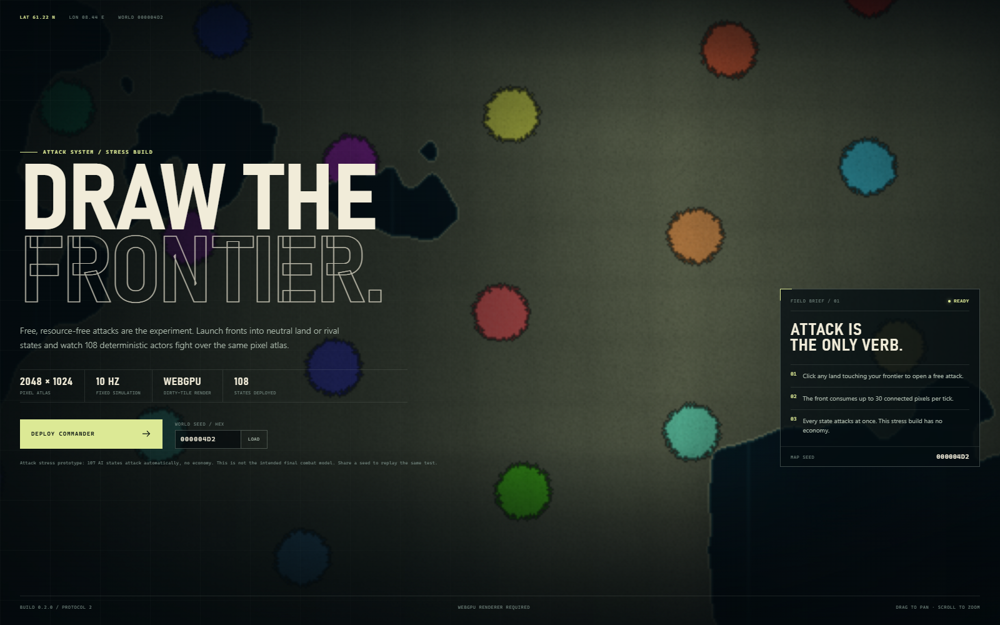

# TERRITORY

**A deterministic, WebGPU-rendered pixel territory war.** Every pixel of the 2048 × 1024 atlas is land, ocean, or somebody's country.


<details>
<summary>More screens</summary>




</details>

> **Status: attack stress experiment (v0.18.0).** Troops, production caps, and launch costs remain removed, but attack orders recover on a timer and a light human gold/card economy drives buildable structures and terrain defense. **This is not the intended final combat model.** See [docs/EXPERIMENTS.md](docs/EXPERIMENTS.md).
>
> The current build runs **108 states** (1 human + 107 AI) to stress-test free attacks, territory flood fill, frontier bookkeeping, dirty-tile rendering, and the HUD. It includes three switchable growth layers: **circular**, **smooth**, and **organic**. Online multiplayer remains specified but **not wired up**.

---

## What this build demonstrates

| Area            | Implementation                                                                                                                              |
| --------------- | ------------------------------------------------------------------------------------------------------------------------------------------- |
| Attack stress   | 108 states, State structures, three growth layers, 3 human / 2 bot attack orders with embedded-order attacks, terrain defense               |
| Large pixel map | 2,097,152 ownership cells rendered from a single GPU control texture, nearest-neighbour sampled, with pixel-grid and terrain shader detail  |
| Terrain defense | Six elevation tiers color the map; defense is `1 + elevation + occupied + aura`; embedded attack orders scale points and piercing           |
| State auras     | Live capitals project a 16 px field of +20 defense                                                                                          |
| Build economy   | 3 starting gold, continuously accrued income, all five cards always available, repeatable drag/drop builds, click-to-upgrade districts      |
| Districts       | Bounded owner-local Voronoi districts with noisy extents/borders, type tint/boundaries, district-wide defense auras, same-type stacking     |
| Determinism     | Fixed 10 Hz tick, seeded integer PRNG, stable command order, FNV-1a checksums, deterministic tests                                          |
| Rendering speed | Full-screen WebGPU pass; changed 32 × 32 tiles are merged into strips, with heavy-load full resyncs split across frames to protect input    |
| UI scale        | Virtualized 108-state leaderboard (only visible rows in DOM), 5 Hz HUD snapshots, generated palette, minimap, attack counters, perf readout |
| Tooling         | SvelteKit 3 + Svelte 5 + TypeScript, Vitest determinism/stress tests, benchmark script, CI workflow                                         |

## Quick start

**Requirements:** Node.js ≥ 24, pnpm ≥ 11, and a WebGPU-enabled browser (current Chrome or Edge on desktop).

```sh
pnpm install
pnpm dev
```

Open the URL printed by Vite (normally <http://localhost:5173>). Append a seed to replay a world:

```text
http://localhost:5173/?seed=1234
```

### Commands

```sh
pnpm dev        # Vite dev server (HMR)
pnpm check      # svelte-check + TypeScript
pnpm test       # deterministic + 108-state stress tests
pnpm bench      # map/tick/checksum benchmark
pnpm build      # production build via adapter-node
pnpm preview    # preview the production build
pnpm lint       # Prettier check
pnpm format     # Prettier write
```

## Controls

| Input                       | Action                                                       |
| --------------------------- | ------------------------------------------------------------ |
| Click / tap a shared border | Open a free attack front into neutral land or a rival state  |
| Click / tap your district   | Upgrade that district's structure by one level for gold      |
| Drag                        | Pan the map                                                  |
| Scroll                      | Zoom at the pointer                                          |
| `Space`                     | Pause / resume the simulation                                |
| `F`                         | Fit the whole atlas                                          |
| `C`                         | Return to your beachhead                                     |
| `+` / `−`                   | Zoom                                                         |
| `H`                         | Open the field manual                                        |
| Minimap click               | Jump the camera                                              |
| Growth switcher             | Select circular / smooth / organic for **new** attack orders |
| Drag a build card           | Drop on controlled land to buy/build that structure          |
| Refresh button              | Spend 1 gold to replace the hand with three new cards        |

A click must be on land near a shared border. The simulation reports ocean, own territory, no-shared-border, and no-attack-orders failures. Attacks consume attack orders; build cards cost gold.

## How the attack works right now

1. Click a target cell near your frontier.
2. The simulation finds up to 96 target-owned cells within 34 px that touch your territory.
3. A launch consumes one attack order: start with 3 for the human and 2 for bots. Every 10 seconds each living player gains 1 order, up to the cap; orders do not refund when a front ends.
4. Each attack embeds **1 order plus one per live Barracks stack**. More embedded orders mean more capture points, defense piercing, and lifetime. The launch still costs one inventory order; clicking again creates a separate attack, never upgrades the first.
5. Each tick, a front has **30 + 15 per extra embedded order attack points**. Capturing a pixel costs `max(1, defense − embeddedOrders + 1)`: `1 + elevation`, plus **1 if occupied**. Flat neutral land costs 1, defended lowland costs 2, and defended peaks cost 7.
6. A front captures connected target-owned pixels until its attack budget is spent, traversing through the target's territory. High ground and occupied land therefore fall more slowly.
7. Every captured pixel must still touch the attacker's territory at capture time. If another front cuts the connection, queued pixels are discarded.
8. A front with no legal captures in a tick peters out immediately, so fronts cannot phase through each other and leave enclaves.
9. **Least resistance:** each capture samples the 10 highest-priority frontier cells and takes the cheapest local defense, so a front slides around a costly strongpoint into weaker ground while keeping its overall growth shape.
10. **Orders are finite:** every front expires after `50 + 10 per extra embedded order` ticks.
11. **Mutual fronts attrit:** if two states attack each other and their fronts touch, the defender spends available orders up to its issued attack strength, stripping one embedded order per spent order. A 2-order attack needs two 1-order defensive clashes; if the defender runs out, the attack breaks through.
12. **State structures anchor territory:** each state begins with a State structure at its capital. Every land component connected to a live State structure is protected from annexation.
13. **Detached land is annexed:** every second, unprotected land touching a foreign protected mainland is transferred to the owner with the largest shared border. Capturing a State structure destroys it and removes that state's annexation protection.

### Terrain and defense

The map has six discrete elevation tiers: **lowland, plains, hills, highlands, mountains, peaks**. Elevation is part of the generated map, rendered as a green-to-ochre-to-grey-to-snow palette and marked with subtle contour boundaries.

| Property                         | Value                                           |
| -------------------------------- | ----------------------------------------------- |
| Base defense                     | `1 + elevation tier` (1–6)                      |
| Occupied bonus                   | `+1`                                            |
| State aura                       | `+20` within 16 px, max once                    |
| Attack points per front per tick | 30                                              |
| Capture cost                     | Target pixel defense                            |
| Attack orders                    | Start 3 human / 2 bots; +1 per 10s, cap-limited |
| Command Post                     | +1 order per 60s                                |
| War Academy                      | +1 order cap                                    |

Hovering a land cell updates the compact defense readout beside the card hand; its tooltip shows elevation, base defense, and aura details. Grid reference and target-description panels were removed to keep vertical space clear.

### Growth layers

The HUD selector switches the frontier-selection strategy used by attacks created from the next tick onward. Existing orders keep the layer they started with, so you can compare layers in the same match.

| Layer        | Behavior                                                                              |
| ------------ | ------------------------------------------------------------------------------------- |
| **Circular** | Euclidean-priority frontier; expands as a digital disc instead of a Manhattan diamond |
| **Smooth**   | Radial bands with concavity filling; suppresses tangent wings and thin spikes         |
| **Organic**  | Deterministic random frontier selection; irregular, organic lobes                     |

Circular and smooth both grow radially from the border and can look similar by design; smooth trades exact circularity for banded concavity filling. Organic is the visually distinct mode.

### Structures

Each state starts with one **State structure** at its capital. It is the anchor for that state's protected mainland: every territory component connected to a live State structure cannot be annexed. The structure is visible as a large owner-colored circle with a cream capital star on the map, and a ringed dot on the minimap.

The State also projects a **16 px defensive aura** that adds **+20 defense** to every land pixel inside it. Overlapping auras use the strongest bonus, not a sum. Aura circles were removed; districts provide the territorial tint instead.

State structures can be captured like any other land cell. The structure is destroyed when its cell changes owner; its aura disappears immediately, and the state keeps its territory but loses annexation protection. The top bar shows the human state's anchored status.

### Build cards

The human commander starts with **3 gold** and **all five build cards** permanently available. Base income is **1 gold per 10 seconds**, plus 1 per live Mine level; it is paid continuously across the interval rather than as a lump sum. Drag any affordable card into your territory to buy it; cards are never consumed, so the same card can be bought again as soon as you can afford it. Clicking any pixel of one of your districts upgrades its structure by one level for its **base card cost plus its current level**:

| Card         | Cost | Effect                                                     |
| ------------ | ---- | ---------------------------------------------------------- |
| Mine         | 3    | +1 gold per 10 seconds, paid continuously                  |
| Barracks     | 2    | Your attacks now issue 1 extra order per stack             |
| Defense Post | 2    | +5 defense to every friendly pixel in its district; stacks |
| Command Post | 4    | +1 attack order per 60 seconds, paid continuously          |
| War Academy  | 6    | +1 attack-order cap                                        |

There is no deck, draw, or reroll. Built structures are razed when captured.

Defensive auras only protect land owned by the structure's owner, so a Defense Post never raises the defense of neutral or enemy pixels and cannot slow that owner's attacks. A Defense Post covers its **entire district**, not just a small radius. Barracks is not an aura: every stack adds one embedded order to all of that owner's attacks.

### Districts

Every buildable structure claims a **district** from its owner's territory. State capitals are aura anchors only; they do not claim a district, so they never lock the whole starting territory out of building:

- districts are a constrained Voronoi split: each owned cell belongs to the nearest eligible structure of that owner;
- a district never crosses an ownership border or exceeds its structure's range;
- districts cannot overlap;
- auras only affect the owning structure's district;
- multiple structures and districts of the same type are allowed;
- dropping the same type inside a district **stacks** onto that district's structure, multiplying its effect;
- dropping the same type outside all districts creates another structure/district;
- a different type cannot be dropped inside any existing district.

| Structure    | District range | Stack effect      |
| ------------ | -------------: | ----------------- |
| Mine         |             32 | +1 income         |
| Barracks     |             44 | +1 embedded order |
| Defense Post |             40 | +5 defense        |
| Command Post |             32 | +1 order per 60s  |
| War Academy  |             32 | +1 order cap      |

District extents and borders are perturbed by deterministic integer noise: coherent 8 px value noise plus fine jitter makes each district grow or shrink by roughly two pixels and gives Voronoi splits an irregular edge. The geometry follows the actual coverage used by auras and placement.

District pixels receive a subtle structure-type tint, a per-district brightness variant, and darkened boundaries in the WebGPU territory shader. This keeps even adjacent same-type districts distinguishable.

Structures must be at least **8 px apart** (centre to centre); dropping a new type too close to any existing structure is rejected. Structure icons are larger now: 15 px radius for the human State, 11 px for AI States, and 10 px for buildables. These are screen-space sizes, so icons do **not** grow as you zoom in.

The hand is presented as free-floating CCG-style cards at the bottom center, with no enclosing tray and no empty placeholders: cards enter from below, lift on hover, and tilt while dragged. The hand sinks to a semi-hidden peeking strip when the pointer leaves and rises when the pointer returns to it. The native drag ghost is suppressed; a curved accent arrow follows the cursor, and the landing circle shows the 8 px exclusion radius in green or red. Gold, attack orders, and hovered defense share a compact panel beside the hand; grid/target text panels are gone.

The HUD shows available **attack orders / cap**. Gain +1 order every 10 seconds up to the cap. Command Posts accrue +1 order per 60 seconds continuously, clamped to the cap; War Academies permanently raise the cap while alive. Barracks stacks increase the orders embedded in each attack, not the inventory cap.

This is deliberately provisional. See [docs/EXPERIMENTS.md](docs/EXPERIMENTS.md) for the stress rules and the exit plan.

## Architecture at a glance

```text
Svelte UI (+page.svelte)
  └── GameCanvas.svelte ......... fixed-step driver, pointer input, camera bridge
        ├── TerritorySimulation .. pure deterministic game core
        │     ├── generateMap .... seeded, versioned 2048 × 1024 atlas + 108 starts
        │     ├── TerritoryRng ... mulberry32
        │     ├── growth/ ........ circular / smooth / organic frontier layers
        │     ├── Structures/ .... one file per structure type + registry
        │     ├── integrity.ts ... detached-territory annexation
        │     └── attacks ........ contiguous flood fronts with finite orders
        ├── TerritoryRenderer .... WebGPU device, shader, adaptive chunked uploads
        └── MapCamera ............ CSS-pixel camera, zoom, clamping
  └── Minimap.svelte ............ 2D overview, throttled independent redraw
```

Read [docs/ARCHITECTURE.md](docs/ARCHITECTURE.md) for module responsibilities and data flow.

## Measured baseline

Ballpark figures from the included benchmark on the development machine (Windows, Node 24, headless Chrome with hardware acceleration). Treat them as regression baselines, not universal claims.

| Measurement                               | Result                                               |
| ----------------------------------------- | ---------------------------------------------------- |
| Map generation + 108 starts               | ~292 ms, one-time on world creation                  |
| Default (circular) all-bot attack tick    | ~1.3 ms                                              |
| Smooth-layer all-bot attack tick          | ~1.3 ms                                              |
| Organic-layer all-bot attack tick         | ~1.1 ms                                              |
| Full-state checksum                       | ~18.1 ms (on-demand; includes claim provenance)      |
| Browser render loop with cards + auras    | 142 fps; p99 7.1 ms; isolated cleanup spikes         |
| Upload strategy under stress              | adaptive full-texture chunks: ~21M px/s, ~80 calls/s |
| Full control texture                      | 8 MiB VRAM + 8 MiB CPU shadow                        |
| Node benchmark RSS (all benchmark worlds) | ~338 MiB                                             |

At 10 Hz, the attack-heavy simulation uses roughly 1.6–2.9% of a 100 ms tick budget depending on growth layer. Territory-integrity scans are limited to once per second and average under 1 ms/tick. Panning smoothness is protected by spreading heavy texture uploads across frames and by keeping the 108-row leaderboard virtualized to the visible window. See [docs/PERFORMANCE.md](docs/PERFORMANCE.md).

## Determinism guarantees

1. Every client and server runs the same simulation code at the same fixed 10 Hz tick.
2. The map is generated deterministically from a 32-bit seed and a **map version**. Changing map or start generation requires bumping `MAP_VERSION`.
3. Attack outcomes depend on integer positions, ownership, queue order, and command order — never on frame rate, camera, or rendering.
4. Bots draw from one seeded PRNG in a fixed player order.
5. Commands are applied at tick boundaries in a stable order.
6. State checksums can be compared across clients and servers; a mismatch forces a resync rather than silently diverging.

The attack experiment is still subject to the full determinism contract in [docs/DETERMINISM.md](docs/DETERMINISM.md).

## Project map

```text
src/
  app.css                        design tokens and resets
  routes/
    +page.svelte                 game shell, HUD, overlays, controls
    +page.ts                     client-only route (ssr = false)
  lib/
    components/
      GameCanvas.svelte          canvas lifecycle, fixed loop, pointer handling
      Minimap.svelte             throttled 2D overview
    game/
      constants.ts               attack stress rules, 108-state palette/names
      rng.ts                     deterministic PRNG
      map.ts                     map generation and 108 start placement
      simulation.ts              world state, free attacks, bots, checksums
      simulation.test.ts         determinism, ownership, frontier, stress tests
      growth/                    switchable circular/smooth/organic frontier layers
      net/protocol.ts            multiplayer wire protocol draft
      render/
        camera.ts                pan / zoom / clamp logic
        camera-bridge.ts         imperative bridge for Svelte controls
        territory.wgsl.ts        full-screen WGSL map shader
        territory-renderer.ts    WebGPU setup, control texture, dirty uploads
docs/
  SPEC.md                        canonical product + technical specification
  EXPERIMENTS.md                 active attack stress experiment and exit plan
  ARCHITECTURE.md                module responsibilities and data flow
  DETERMINISM.md                 invariants, replay, multiplayer rules
  RENDERING.md                   WebGPU pipeline and upload strategy
  NETWORKING.md                  authoritative online architecture
  PERFORMANCE.md                 budgets, benchmarks, profiling
  ROADMAP.md                     phased delivery plan
  DECISIONS.md                   architecture decision records
  README.md                      documentation index
scripts/
  benchmark.ts                   attack tick/map/checksum benchmark
AGENTS.md                        orientation for future coding agents
```

## Current limitations

- The economy and final attack semantics are intentionally missing; this build is not game-balanced.
- The 108-state leaderboard and AI load are a stress mode, not the shipping match format.
- Online play, accounts, matchmaking, and persistence are specified but not implemented.
- No audio, fog of war, diplomacy, or spectator camera UI.
- Touch pan/tap works; pinch-to-zoom is not implemented yet.
- WebGPU is required. There is no WebGL/Canvas2D fallback.
- The simulation runs on the main thread.

## Documentation index

| Document                                     | Read it for                                            |
| -------------------------------------------- | ------------------------------------------------------ |
| [docs/SPEC.md](docs/SPEC.md)                 | The canonical game and technical specification         |
| [docs/EXPERIMENTS.md](docs/EXPERIMENTS.md)   | Temporary attack stress rules, findings, and exit plan |
| [docs/ARCHITECTURE.md](docs/ARCHITECTURE.md) | Code map, data flow, extension points                  |
| [docs/DETERMINISM.md](docs/DETERMINISM.md)   | Rules that keep every client in lockstep               |
| [docs/RENDERING.md](docs/RENDERING.md)       | WebGPU pipeline, texture layout, upload batching       |
| [docs/NETWORKING.md](docs/NETWORKING.md)     | Authoritative server, protocol, latency, anti-cheat    |
| [docs/PERFORMANCE.md](docs/PERFORMANCE.md)   | Budgets, measured baseline, profiling playbook         |
| [docs/ROADMAP.md](docs/ROADMAP.md)           | Phased plan and acceptance criteria                    |
| [docs/DECISIONS.md](docs/DECISIONS.md)       | Why the stack and engine work this way                 |
